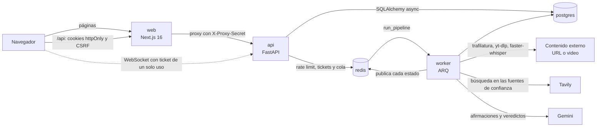

# FakesNews

Plataforma que verifica noticias sospechosas con ayuda de IA. Lleva un perfil histórico de la confiabilidad de cada fuente y tiene verificación en dos pasos (TOTP) opcional.

**Web en producción:** https://fakesnews.vercel.app

**Principio de producto:** la plataforma nunca declara una noticia «verdadera» o «falsa». Entrega un reporte de credibilidad trazable: las afirmaciones del contenido, las fuentes concretas que las respaldan o las contradicen, y el historial de confiabilidad de cada fuente. Toda conclusión lleva citas (URL, fragmento y fecha). Sin citas válidas, el veredicto es `INSUFFICIENT`.

## Demo en 5 minutos

```bash
cp .env.example .env          # genera JWT_SECRET_KEY y TOTP_SECRET_ENCRYPTION_KEY (ver el archivo)
docker compose up --build -d  # web, api, worker, postgres y redis
make seed                     # usuario demo con 2FA y casos de ejemplo ya procesados
```

`make seed` imprime el email y la contraseña del usuario demo, su secreto TOTP y 10 códigos de recuperación. Añade el secreto a Google Authenticator o Authy, o genera el código con `pyotp.TOTP(secreto).now()`. Sin `make` (por ejemplo en Windows sin GNU Make), usa `docker compose exec api uv run python -m app.cli.seed_demo`.

Después:

1. Entra en http://localhost:3000/login con el email, la contraseña y el código TOTP. Llegas a `/history`.
2. Abre el caso «Mensaje viral de WhatsApp…». El reporte tiene una afirmación respaldada, una contradicha y una con evidencia insuficiente, cada una con sus citas y la confiabilidad de cada fuente.
3. El caso de URL muestra la deduplicación por sindicación: `bbc.com` y `bbc.co.uk` cuentan como una sola voz independiente. El caso fallido muestra cómo se ve un error del pipeline.
4. `/sources` es pública y lista la confiabilidad de las 25 fuentes de confianza.
5. `/submit` envía un caso real. **Requiere `GEMINI_API_KEY` y `TAVILY_API_KEY` en `.env`.** Sin ellas, el caso recorre la cola y termina en `failed`, y eso también se ve en la interfaz.

Sobre el seed (`apps/api/app/cli/seed_demo.py`):

- Es idempotente. El secreto TOTP se conserva entre ejecuciones; los códigos de recuperación se regeneran, porque su texto plano nunca se guarda.
- Se niega a correr con `ENVIRONMENT=production`, salvo con `--production` (ver [Despliegue](#despliegue)).
- Marca todo el contenido con `[DEMO]` y cada fragmento de evidencia como ilustrativo.
- No actualiza la reputación de las fuentes, así que los datos inventados de la demo no contaminan los scores reales.

## Arquitectura



En local, el navegador llama a la API directamente (`NEXT_PUBLIC_API_URL=http://localhost:8000`). En producción pasa por el proxy `/api` de la web (ver [La web hace de proxy de la API](#la-web-hace-de-proxy-de-la-api)).

| Componente | Responsabilidad |
| --- | --- |
| `apps/web` | Interfaz en Next.js 16 (App Router). `proxy.ts` reenvía `/api` a la API y redirige a `/login` cuando falta la cookie. **La API es el único límite de autorización.** `lib/api.ts` renueva la sesión ante un `401`. |
| `apps/api`: `auth` | Registro, inicio de sesión con verificación en dos pasos TOTP opcional, sesión con access token y refresh rotativo, CSRF de doble envío, bloqueo y rate limit. |
| `apps/api`: `submissions` | Crea los casos y los encola. Expone el estado por HTTP y por WebSocket. |
| `apps/api`: `pipeline` | El worker: `ingest → transcribe → claims → verify → scoring`. Valida cada cita contra los resultados reales de la búsqueda y la lista de dominios de confianza. |
| `apps/api`: `sources` | Las fuentes de confianza y su reputación Beta-Bernoulli ([docs/reputation.md](docs/reputation.md)). |
| `apps/api`: `reports` | Arma el reporte de solo lectura con lo que ya está guardado, sin llamar al modelo. |
| `apps/api`: `vitals` | Recibe las métricas INP, LCP y CLS del navegador y las escribe en el log. |
| `apps/api`: `cli` | `seed_demo` para la demo. |
| `apps/api/evals/verdicts` | Evaluación de la calidad de los veredictos con 20 casos reales. |

### Flujo de un caso

1. `POST /submissions` crea la fila en estado `queued` y encola el trabajo en Redis.
2. El worker avanza el estado: `ingesting → transcribing → extracting → verifying → scoring → done` (o `failed`). En cada cambio publica el estado en el canal de Redis `submission:{id}`.
3. `/reports/[id]` llega con SSR y streaming, con el estado actual del caso.
4. Si el caso sigue en proceso, el navegador pide un ticket y abre un WebSocket contra la API, que le reenvía cada estado. Si el WebSocket falla, la página vuelve al sondeo de `GET /submissions/{id}` cada 2 s.
5. Al llegar a `done`, la página pide `GET /reports/{id}`.

### El pipeline de verificación

- **Ingesta.** `trafilatura` extrae el texto de una URL. Para un video, `yt-dlp` lo descarga y `faster-whisper` lo transcribe (interfaz `Transcriber` intercambiable). La duración se valida antes de descargar y la descarga tiene un tope de tamaño.
- **Afirmaciones.** Gemini extrae hasta 4 afirmaciones factuales autocontenidas (`MAX_CLAIMS_PER_SUBMISSION`) y descarta opiniones y predicciones. La respuesta se valida contra un esquema Pydantic.
- **Verificación.** Para cada afirmación, Tavily busca solo en los dominios de `sources` y Gemini propone un veredicto con sus evidencias. El modelo separa la afirmación en partes (datos, cifras, superlativos y alcances) y marca cada una como confirmada, sin confirmar o contradicha.
- **Puntuación.** El paso `scoring` actualiza la reputación de cada fuente.

Los veredictos posibles son cuatro:

| Veredicto | Significado |
| --- | --- |
| `SUPPORTED` | Las fuentes de confianza la respaldan. |
| `CONTRADICTED` | Las fuentes de confianza la contradicen. |
| `CHANGED` | Fue cierta y dejó de serlo, o solo es cierta en parte. La web muestra una línea de tiempo. |
| `INSUFFICIENT` | No hay evidencia válida suficiente. |

**Modelo de confianza respecto al LLM.** El modelo propone veredictos y citas, pero no se confía en él a ciegas:

- Ninguna cita llega al reporte sin pasar dos chequeos deterministas: la URL tiene que estar en los resultados reales de la búsqueda de esa afirmación, y su dominio tiene que estar en la lista de confianza.
- Sin citas válidas, el veredicto se fuerza a `INSUFFICIENT`.
- Un `SUPPORTED` con alguna parte sin confirmar baja a `CHANGED`, o a `INSUFFICIENT` si solo hay una cita.
- Los fragmentos de las citas se recortan con reglas fijas (`snippet.py`), sin modelo.
- El contenido del usuario y la afirmación viajan delimitados y marcados como no confiables, como defensa contra la inyección de prompts.
- Un fallo técnico (cuota agotada, sin fuentes de confianza) se registra como `verification_failed`, no como un `INSUFFICIENT` que parecería un resultado.

Las verificaciones corren en paralelo con un semáforo y un tiempo máximo por afirmación. Un fallo en una afirmación no tumba el resto del caso.

### Reputación de las fuentes

Cada fuente tiene un score con un modelo Beta-Bernoulli (`score = alpha / (alpha + beta)`):

- consenso ponderado entre fuentes (el peso es el score actual, con un piso de 0,05);
- deduplicación de fuentes sindicadas (`syndication_group`), para que no inflen el conteo de independencia ni el voto de consenso;
- mínimo de 2 fuentes independientes para puntuar;
- idempotencia por una restricción única `(source_id, claim_id)` en `source_score_events`.

`GET /sources` y `GET /sources/{domain}` exponen el score, `cases_count`, la bandera `low_sample` (menos de 10 casos), un intervalo aproximado y el historial reciente. La fórmula completa y sus limitaciones están en [docs/reputation.md](docs/reputation.md).

### Renderizado, tiempo real y métricas

| Ruta | Patrón |
| --- | --- |
| `/` | SSG |
| `/sources` | ISR cada 60 s |
| `/reports/[id]` | SSR con streaming |
| `/history`, `/submit`, `/settings/security`, `/login`, `/register` | CSR |

- **WebSocket.** El progreso del caso llega por `WS /ws/submissions/{id}`. El navegador se conecta directo a la API con un ticket de un solo uso que dura 30 s. La API valida el `Origin`, canjea el ticket y comprueba que el caso es del usuario. Hay un tope de 5 sockets por usuario.
- **`BroadcastChannel`.** Al cerrar sesión en una pestaña, las demás salen solas.
- **Web Vitals.** `useReportWebVitals` mide INP, LCP y CLS y los envía a `POST /vitals`.

El detalle, con archivo y línea de cada pieza y cómo comprobarlo en vivo, está en [docs/RENDERIZADO.md](docs/RENDERIZADO.md).

### Endpoints

| Método y ruta | Auth | Descripción |
| --- | --- | --- |
| `POST /auth/register` | — | Crea la cuenta (argon2id). |
| `POST /auth/login` | — | Sin 2FA emite la sesión (`status: "authenticated"`). Con 2FA devuelve un token limitado `mfa_pending` (`status: "mfa_required"`). |
| `POST /auth/2fa/setup` · `/auth/2fa/confirm` | sesión + CSRF | Activa o reconfigura TOTP y genera los códigos de recuperación. |
| `POST /auth/2fa/disable` | sesión + CSRF + código | Desactiva la 2FA con un código TOTP o de recuperación. |
| `POST /auth/2fa/verify` | token limitado | Emite la sesión completa (cookies). |
| `POST /auth/refresh` · `/auth/logout` | cookie + CSRF | Rota o revoca la sesión. |
| `GET /auth/me` | sesión | Usuario actual. |
| `POST /submissions` | sesión + CSRF | Crea y encola un caso. |
| `GET /submissions` | sesión | Historial de casos propios, paginado con `limit` y `cursor`. |
| `GET /submissions/{id}` | sesión | Estado de un caso propio. |
| `POST /submissions/{id}/ws-ticket` | sesión + CSRF | Emite el ticket de un solo uso para el WebSocket. |
| `WS /ws/submissions/{id}?ticket=…` | ticket + `Origin` | Estados del caso en directo. |
| `GET /reports/{id}` | sesión | Reporte de un caso `done` propio (`409` si no terminó, `404` si es ajeno). |
| `GET /sources` · `/sources/{domain}` | — | Confiabilidad pública de las fuentes. |
| `POST /vitals` | — | Recibe una métrica web. Tiene rate limit por IP y un cuerpo de 2 KB como máximo. |
| `GET /health` · `/health/ready` | — | Liveness y readiness (base de datos y Redis). |

La documentación interactiva completa está en http://localhost:8000/docs.

## Seguridad

El análisis completo, según OWASP Top 10:2025, está en [docs/SEGURIDAD.md](docs/SEGURIDAD.md). En resumen:

- **Contraseñas:** argon2id, reglas de fortaleza y una lista local de contraseñas filtradas.
- **2FA opcional con TOTP:** secreto cifrado en reposo con Fernet, ventana de ±1, protección contra la reutilización del código y 10 códigos de recuperación de un solo uso. Al desactivarla se revocan las demás sesiones.
- **Sesión:** access token de 15 minutos y refresh rotativo, en cookies `httpOnly` y `SameSite=Lax` (`Secure` con `ENVIRONMENT=production`). Si se reutiliza un refresh token, se revoca toda su familia.
- **CSRF** de doble envío, **bloqueo temporal** tras 5 intentos fallidos y **rate limit** por IP y por usuario.
- **SSRF:** la ingesta valida el esquema y resuelve el host antes de descargar, y rechaza loopback, redes privadas y endpoints de metadata de la nube. Cada redirección se vuelve a validar (hasta 5) y la conexión va a la misma IP que se validó, lo que cierra el DNS rebinding. Los videos solo se aceptan de una lista de plataformas (`ALLOWED_VIDEO_HOSTS`).
- **Web:** CSP estática (`lib/csp.mjs`), HSTS y solo enlaces `http(s)` en las evidencias.
- **Cuotas por usuario:** casos por minuto, por día y activos a la vez, y afirmaciones por mes.

### Cómo probar la 2FA a mano

La verificación en dos pasos es opcional. Una cuenta sin 2FA entra solo con la contraseña, y la interfaz le recuerda activarla. La garantía es que **una cuenta con 2FA no puede abrir sesión solo con la contraseña**: el token `mfa_pending` no da acceso a ninguna ruta protegida y solo vale una vez.

1. `POST /auth/register` con `email` y `password`.
2. `POST /auth/login` devuelve `{"status": "authenticated", ...}` y las cookies `access_token`, `refresh_token` y `csrf_token`.
3. `POST /auth/2fa/setup`, con esas cookies y `X-CSRF-Token: <csrf_token>`, devuelve `otpauth_uri` y `qr_code_base64`. Decodifica el QR o saca el parámetro `secret` de la URI, y genera el código con cualquier librería TOTP (por ejemplo `pyotp.TOTP(secret).now()`).
4. `POST /auth/2fa/confirm` (cookies y CSRF) con `{"code": "<código de 6 dígitos>"}` activa la 2FA y devuelve 10 `recovery_codes`, que solo se muestran una vez.
5. Un nuevo `POST /auth/login` devuelve `{"status": "mfa_required", "token": ...}`. Envía `POST /auth/2fa/verify` con `Authorization: Bearer <token>` y `{"code": "..."}` o `{"recovery_code": "..."}` para obtener la sesión.
6. `POST /auth/2fa/disable` (cookies y CSRF) con `{"code": "..."}` o `{"recovery_code": "..."}` desactiva la 2FA y borra el secreto y los códigos de recuperación.
7. Desde el navegador, `/settings/security` activa, reconfigura o desactiva la 2FA. Con ella activa, `/login` pasa por `/login/2fa`.

## Cómo levantar el proyecto

```bash
cp .env.example .env
# Edita .env: como mínimo, genera JWT_SECRET_KEY y TOTP_SECRET_ENCRYPTION_KEY
# (las instrucciones están en el archivo). Para verificar casos reales, añade
# GEMINI_API_KEY y TAVILY_API_KEY.

docker compose up --build
make seed   # opcional: usuario demo y casos de ejemplo (ver «Demo en 5 minutos»)
```

- Web: http://localhost:3000
- API: http://localhost:8000 (documentación interactiva en http://localhost:8000/docs)
- Postgres 18: `localhost:5432`. Redis 7: `localhost:6379`.

### Backend sin Docker

```bash
cd apps/api
uv sync
uv run pytest
uv run ruff check .
```

### Frontend sin Docker

```bash
cd apps/web
pnpm install
pnpm dev
pnpm run lint        # ESLint
pnpm run lint:css    # Stylelint
pnpm run test:api    # Vitest con MSW
pnpm run test:lib    # node --test
pnpm run test:e2e    # Playwright
```

### Variables de entorno

Están todas en `.env.example`, en la raíz, cada una documentada ahí mismo. Nunca subas al repositorio el archivo `.env` real.

## Despliegue

La web está en **Vercel**. La API, el worker, PostgreSQL y Redis están en **Azure** (grupo de recursos `rg-fakesnews-prod`, región `northcentralus`). Toda la infraestructura está descrita en Bicep en [`infra/`](infra/). El runbook de operación (desplegar, ver logs, migraciones, backups, secretos y presupuesto) está en [docs/AZURE.md](docs/AZURE.md).

| Pieza | En Azure |
|---|---|
| API | Container App `ca-fakesnews-api`, con 1 réplica siempre encendida |
| Worker | Container App `ca-fakesnews-worker`, que escala de 0 a 1 según los casos sin terminar (KEDA consulta Postgres) |
| Redis | Container App `ca-fakesnews-redis`, con ingress TCP interno y contraseña |
| PostgreSQL | Flexible Server 18 (B1ms) con acceso privado en la VNet. La API y el worker usan un rol sin permisos de DDL |
| Secretos | Key Vault. Las apps los leen por referencia con su managed identity |
| Imágenes | `ghcr.io/santiagotyrsarv/fakesnews-api` |

### CI/CD

| Workflow | Qué hace |
|---|---|
| [`web.yml`](.github/workflows/web.yml) | ESLint, Stylelint, `tsc`, pruebas y build de la web. |
| [`api.yml`](.github/workflows/api.yml) | Ruff y pytest. |
| [`api-deploy.yml`](.github/workflows/api-deploy.yml) | Con cada push a `main` que toca `apps/api`: construye la imagen, ejecuta `alembic upgrade head` en el job `caj-fakesnews-migrate` y, solo si las migraciones terminan bien, actualiza la API y el worker. |
| [`infra.yml`](.github/workflows/infra.yml) | Despliega los cambios de `infra/`. |
| [`osv.yml`](.github/workflows/osv.yml) | OSV-Scanner semanal y con cada cambio de lockfile. |
| [`uptime.yml`](.github/workflows/uptime.yml) | Cada 6 horas comprueba la web y `/api/health/ready`. |

`api-deploy` e `infra` entran en Azure por OIDC, con una managed identity cuya credencial federada solo acepta `main`, así que en GitHub no hay ningún secreto de Azure. Dependabot actualiza npm, uv y las Actions, y SonarQube Cloud analiza cada PR.

### La web hace de proxy de la API

La web (`*.vercel.app`) y la API (`*.azurecontainerapps.io`) no comparten dominio, así que las cookies de sesión no llegarían. Por eso la web hace de proxy de la API en `/api`, y las cookies quedan en el dominio de la web:

- En Vercel (directorio raíz `apps/web`): `NEXT_PUBLIC_API_URL=/api` (se lee al compilar), `API_PROXY_TARGET=https://<api>.azurecontainerapps.io`, `API_PROXY_SECRET=<secreto aleatorio>` y `NEXT_PUBLIC_WS_URL=wss://<api>.azurecontainerapps.io`.
- En la API: `COOKIE_PATH_PREFIX=/api`, `COOKIE_DOMAIN` vacío, `CORS_ORIGINS=["https://<web>.vercel.app"]`, `TRUSTED_PROXY_HOPS=1` y el mismo `API_PROXY_SECRET` (en Key Vault).

El proxy de `/api` está en `apps/web/proxy.ts`. Reenvía la petición y añade la IP del visitante (`X-Client-IP`, tomada de las cabeceras que fija el edge de Vercel) junto con `X-Proxy-Secret`. La API solo acepta esa IP si el secreto coincide. Quien llame directamente a la API queda identificado por la IP que vio el ingress de Container Apps, que es el único salto que se cuenta con `TRUSTED_PROXY_HOPS=1`. Así nadie puede falsificar la IP añadiendo entradas a `X-Forwarded-For` para saltarse el rate limit.

Este esquema confía en el edge de Vercel. Si alojas la web en otro sitio, asegúrate de que su proxy sobrescriba `X-Real-IP` y `X-Forwarded-For` antes de usar `API_PROXY_SECRET`.

Vercel no hace de proxy de WebSockets. Por eso el navegador abre el WebSocket directo contra la API (`NEXT_PUBLIC_WS_URL`) y se autentica con el ticket de un solo uso, no con la cookie. Sin esa variable, la página usa el sondeo.

### Secretos y usuario demo

Genera los secretos con los comandos documentados en [.env.example](.env.example) y no reutilices claves entre desarrollo y producción. `JWT_SECRET_KEY` y `TOTP_SECRET_ENCRYPTION_KEY` no se pueden rotar sin más: invalidan las sesiones y los secretos TOTP cifrados, y nadie con 2FA podría entrar.

La clave de Gemini tiene que ser de un proyecto sin facturación, porque el plan gratuito no se aplica a un proyecto de prepago.

Para la demo en producción, siembra el usuario demo a propósito:

```bash
az containerapp exec -g rg-fakesnews-prod -n ca-fakesnews-api --command "uv run python -m app.cli.seed_demo --production"
```

Genera una contraseña aleatoria, distinta en cada ejecución, y la imprime una sola vez junto al secreto TOTP. La contraseña fija del repo nunca se usa en producción.

## Pruebas y calidad

- **API:** más de 350 pruebas con pytest, y Ruff.
- **Web:** Vitest con MSW, `node --test` para los módulos `.mjs`, un e2e del flujo principal con Playwright, ESLint, Stylelint y `tsc`.
- **Veredictos:** `apps/api/evals/verdicts/` mide el pipeline contra 20 casos reales. En modo ciego (`--blind`, sin verificadores de datos en la búsqueda) acierta 14 de 20. Lo más débil son los casos mixtos (2 de 5).
- **Dependencias y código:** SonarQube Cloud, OSV-Scanner, Dependabot, Aikido y Checkov.

## Documentación

| Documento | Contenido |
|---|---|
| [docs/README.md](docs/README.md) | Índice de la documentación. |
| [docs/ESTADO.md](docs/ESTADO.md) | **Para retomar el trabajo.** Estado actual, historial de PR y pendientes. |
| [docs/RENDERIZADO.md](docs/RENDERIZADO.md) | Patrones de renderizado de cada ruta, WebSocket, INP y `BroadcastChannel`. |
| [docs/SEGURIDAD.md](docs/SEGURIDAD.md) | Análisis de seguridad. |
| [docs/AUDITORIA.md](docs/AUDITORIA.md) | Auditoría técnica. |
| [docs/AZURE.md](docs/AZURE.md) | Runbook de operación en Azure. |
| [docs/reputation.md](docs/reputation.md) | Modelo de reputación de las fuentes. |

## Limitaciones conocidas

- **Alcance.** El sistema mide la consistencia entre 25 fuentes de una lista fija. No es un verificador objetivo ni cubre medios fuera de esa lista. No hay panel de administración para editar las fuentes: se editan en `app/data/trusted_sources.json`.
- **Veredictos.** Los casos mixtos son el punto débil: cuando las fuentes confirman la parte cierta de una afirmación engañosa, el modelo tiende a dar `SUPPORTED`. Un `SUPPORTED` con una sola cita es el caso más frágil.
- **Búsqueda.** Algunos medios de la lista casi no aparecen en los resultados (por ejemplo EFE), porque el ranking de Tavily deja que un solo medio ocupe todos los puestos.
- **Cuotas externas.** La verificación depende de los planes gratuitos de Tavily (1.000 créditos al mes, 2 por afirmación) y de Gemini. Las cuotas por usuario acotan el uso, pero no sustituyen vigilar esos límites.
- **Reputación.** Tiene una circularidad conocida, documentada en [docs/reputation.md](docs/reputation.md): el peso de cada fuente en el consenso es su propio score, lo que puede reforzar sesgos iniciales. Mide consenso entre fuentes, no verdad objetiva. El intervalo de confianza es una aproximación normal a la Beta.
- **Autenticación.** Una cuenta bloqueada responde `423` en vez de `401`, lo que revela que el email está registrado. `/2fa/confirm` no rota `totp_last_used_step` a propósito, así que el mismo código puede servir para `/2fa/confirm` y el `/2fa/verify` inmediato.
- **Video.** La ruta de video (`yt-dlp` y `faster-whisper`) está cubierta con pruebas unitarias, pero no se ha probado de punta a punta con una descarga real. Se puede apagar con `VIDEO_INGEST_ENABLED=false` (y `NEXT_PUBLIC_VIDEO_INGEST_ENABLED=false` en la web). `yt-dlp` sigue sus propias redirecciones; lo acota la lista de plataformas.
- **Reportes.** Solo existen para casos en estado `done`. Un caso `failed` muestra el error, pero no un reporte parcial. No hay exportación (PDF o Markdown). `evidence.published_at` es texto, no una fecha normalizada.
- **Demo.** Los casos del seed usan evidencia ilustrativa, marcada como tal, con URLs a la portada de cada fuente. En desarrollo, la contraseña del usuario demo es fija.
- **Desarrollo local.** Todo se sirve por HTTP. La bandera `Secure` de las cookies depende de `ENVIRONMENT=production` y de un proxy TLS delante, que no forma parte de `docker-compose.yml`.
